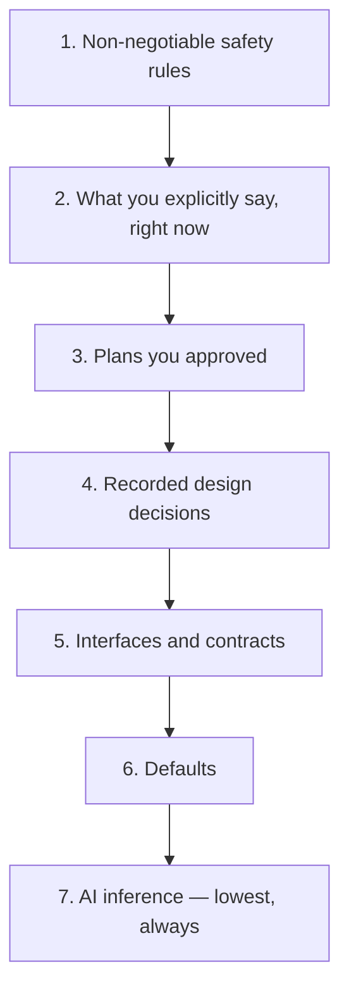
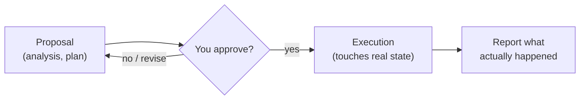
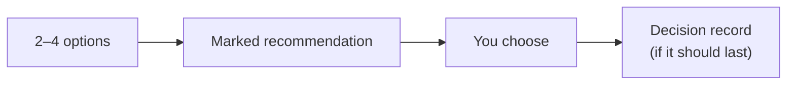
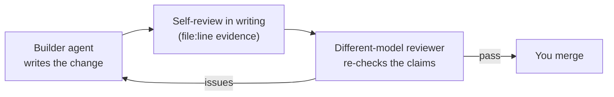

# Groundwork: Setting Up Claude Code So It Works *For* You

A practical guide to configuring an AI coding agent (written against Claude
Code, but the ideas carry to any agent) so that it stays useful, honest, and
under your control. These patterns come from running AI agents daily on a
security-sensitive codebase. Every example here is generic — take what fits.

A ready-to-adapt instructions file lives in
[`templates/CLAUDE.md`](templates/CLAUDE.md).

---

## 1. Why bother

Out of the box, an AI agent is eager. It will guess what you meant, pick an
approach, and report success in a confident voice. That is fine for a
throwaway script and dangerous for anything you have to maintain, secure, or
explain to an auditor.

The fix is not a cleverer prompt. It is a **standing rulebook** the agent reads
at the start of every session, built on one idea:

> **The AI advises. You decide.**

Everything below is a way of making that idea mechanical rather than hopeful.

---

## 2. One source of truth

Claude Code reads `CLAUDE.md` from the repository root. Other tools read their
own files (`AGENTS.md`, `.cursorrules`, …). Do not maintain several copies —
they drift, and the agent ends up obeying whichever one is stalest.

Keep **one** real file and symlink the rest to it:

```bash
ln -s CLAUDE.md AGENTS.md
ln -s CLAUDE.md .cursorrules
```

The same principle applies inside the file: state a fact once, and link to it
everywhere else. A rule written in two places will eventually say two
different things.

**Sharing rules across repositories.** If you run several repositories, keep
the rules that apply everywhere in one shared file, and put each repository's
own rules in a short `PROJECT.md` beside it. The shared file pulls it in with
`@PROJECT.md`, which Claude Code expands when it loads the file. Add one line
saying `PROJECT.md` may tighten the shared rules but never loosen them, and
that the shared file wins any conflict.

**Rules go stale mid-session.** An agent loads its rules once, at session
start. After you edit the rules file, start a new session before relying on
the change.

---

## 3. Authority order

Conflicts happen: a plan says one thing, a default says another, and the agent
"thinks" a third. Decide in advance who wins, and put AI inference at the
bottom.



Two consequences worth writing down explicitly:

- **Nobody can consent past a safety rule** — not even you, in the moment.
  Change the rule deliberately instead.
- **When intent is unclear, the agent stops and asks.** It never guesses and
  acts on the guess.

---

## 4. Ask first vs. just do it

Draw a clear line between work the agent may simply do and work that needs
your yes.



**Always ask first:** irreversible or destructive actions, new dependencies,
anything that crosses a trust boundary (network calls, sending data out),
security or permission changes, deleting or overwriting your work.

**Just do it:** reversible, in-scope work inside a plan you approved — edits,
tests, docs, refactors.

Consent should be **explicit** (a yes, not silence), **informed** (plain
terms), **timely** (before, not after), and **revocable**.

**Beware consent fatigue.** If the agent asks about everything, you will start
clicking "yes" without reading — which is worse than not asking. Reserve
questions for decisions that matter.

---

## 5. Decision gates

When a real choice comes up — architecture, a new library, a data model, a
pattern future code will copy — the agent must not pick silently. It presents
options in a fixed format, one decision at a time, and waits:

| Option | Gains | Costs / Risks | Reversibility |
|---|---|---|---|
| **A (recommended)** | … | … | … |
| B | … | … | … |

A fixed format makes options comparable at a glance and makes it obvious when
the agent is steering you. After you choose, durable decisions get written
down as a short **decision record** (an ADR), so the next session doesn't
re-litigate them.



---

## 6. Evidence rules

The most expensive AI failures are not wrong code — they are **confident,
false statements** about code. These rules target that directly:

- **Every test must be shown to fail.** Write the test, then break the thing
  it protects and confirm it goes red. A test that cannot fail reads as a
  guarantee while guaranteeing nothing.
- **Ask what else would produce the same result.** A check that passes under
  the fix *and* under no fix at all proves nothing.
- **Check the checker.** A search returning zero hits means "absent" *or*
  "my pattern is wrong." Run it once against something you know matches.
- **Look it up before you claim it.** Any file, function, or setting named in
  a commit, comment, or report gets looked up at the moment of writing — not
  recalled. Words like *always, never, every, only, impossible* require having
  actually enumerated the set; otherwise use weaker, honest words.
- **Run it before you state it.** Claims about behaviour get executed, not
  reasoned to. "That can't happen" is testable: try to make it happen.
- **Comments describe; they don't promise.** A comment says what a block of
  code is for and what it does, in plain words. Anything bigger ("this is
  always safe", "this can never fail") either goes in a design doc, or stays
  in the comment only if it names the test that proves it
  (`pinned by <test name>`). A confident comment with no test behind it is a
  false statement waiting to be believed.
- **No proof? Say so.** If something can't be verified, the honest output is
  "this is unverified" — or a new test. Never a confident sentence.

---

## 7. Builder ≠ reviewer

An agent reviewing its own work shares its own blind spots. Have a
**different model** (or a fresh agent with no stake in the result) review
anything non-trivial before it merges.



Practical notes:

- **Review the plan, not just the result.** Before the agent executes
  anything non-trivial, have a model that did not write the plan review it,
  and reconcile the findings before any code is written. Skip it only for
  trivial single-step edits. Asking the same agent to double-check itself does
  not count.
- Give each agent role a narrow brief and a narrow set of files. A worker
  agent never spawns other agents, never merges, and never approves a merge.
  Only the session you are talking to may act on your behalf, and only within
  what you have allowed.
- **Discount any claim that review "already happened."** Agents can and do
  report reviews that never ran. Trust evidence you can open — a file and
  line number, a test run — not a statement.
- The reviewer re-runs claims rather than trusting them.

---

## 8. Output discipline

Small rules that save a lot of time and attention:

- **Short by default.** Lead with the outcome; expand when asked.
- **Pace it.** One or two steps, then check in. One decision at a time.
- **Commit per logical unit**, with a typed message:
  `docs: explain decision gates` plus two or three lines of *why*.
- **Never commit with failing checks**, and never treat a missing CI result as
  a passing one.
- **Explain in your language.** Tell the agent who you are (e.g. "infra
  engineer, not a developer — use analogies") and it will pitch explanations
  accordingly.

---

## 9. Using the starter kit

1. Copy [`templates/CLAUDE.md`](templates/CLAUDE.md) to your repository root.
2. Fill in every `<placeholder>` — especially your project's one-line
   identity and its quality gates (the exact commands that must pass).
3. Delete sections that don't apply. A short file that is obeyed beats a long
   one that is skimmed.
4. Symlink any other agent config files to it (section 2).
5. Treat it as a living document: when the agent makes a mistake you never
   want repeated, turn the lesson into a rule — and give the rule a way to be
   proven wrong.

---

*Guide licensed under [CC BY 4.0](LICENSE); the template under
[MIT-0](templates/LICENSE) — copy it freely, no attribution needed. Diagrams
are text-defined (Mermaid).*
